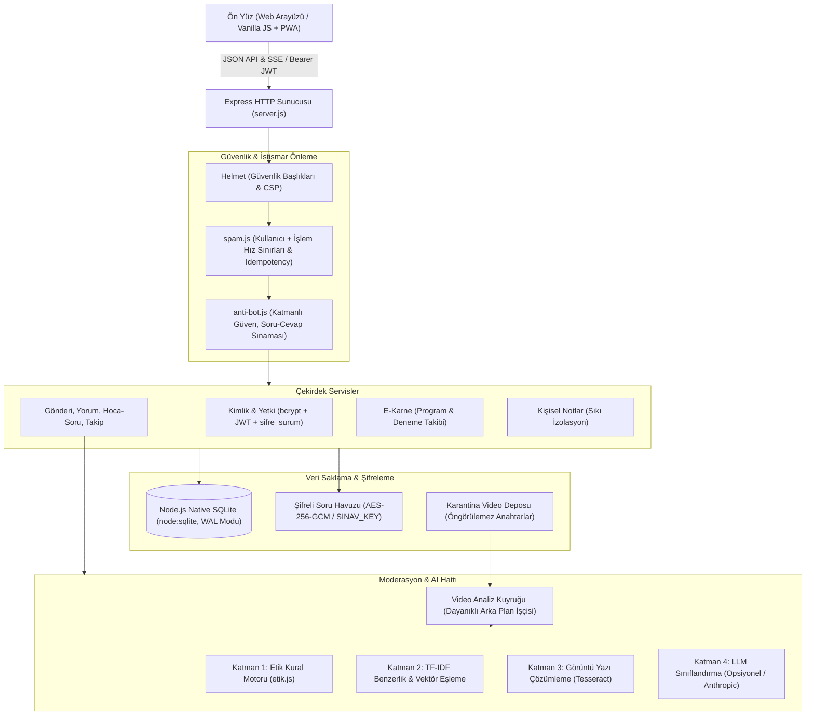

# Sistem Mimarisi (Architecture)

Düzce FENTEK Ödev Destek sistemi, okul içi eğitim paylaşımı, soru-cevap, kişisel çalışma yönetimi, moderasyon ve video çözüm akışlarını tek bir bütünlük içerisinde sunan yerel odaklı bir uygulamadır.

## Güvenlik ve Mimari Sınırlar

### 1. Kimlik ve Yetkilendirme Modeli
- Roller: `ogrenci`, `ogretmen`, `mudur`, `admin`.
- Öğretmen hesapları kayıt olduğunda `onay=0` durumundadır; bir `admin` tarafından onaylanana kadar soru havuzuna erişemez veya özel yetkileri kullanamaz.
- Oturum yönetimi `jsonwebtoken` ile sağlanır. Kullanıcının şifresi değiştiğinde veritabanındaki `sifre_surum` artırılır; bu sayede eski biletler tüm cihazlarda anında geçersiz kılınır.

### 2. Moderasyon ve Etik Karar Boru Hattı
- **Katman 1 (Deterministik Kural Motoru):** Hakaret, tehdit, kopya, sınav sızıntısı ve kişisel veri kalıplarını regex ve leksikal normalizasyonla yakalar.
- **Katman 2 (TF-IDF Benzerlik):** Paylaşılan soruların ve metinlerin kütüphanedeki veya havuzdaki sorularla semantik yakınlığını hesaplar.
- **Katman 3 (Şifreli Sınav Havuzu):** Öğretmenlerin gizli sınav soruları AES-256-GCM ile şifrelenir. Sistem soruları açığa çıkarmadan girdi metniyle eşleşme skoru üretir.
- **Katman 4 (LLM Entegrasyonu):** Harici model isteğe bağlıdır; API anahtarı girilmediğinde sistem tamamen kural ve benzerlik modunda çalışır.

### 3. Video Çözüm & Karantina Yaşam Döngüsü
1. **Yükleme:** Dosya adı kullanıcıdan alınmaz; 24 rastgele baytlık tahmin edilemez kimlik üretilir.
2. **Karantina:** Video dosyası özel klasöre (`VIDEO_STORE`) alınır. Onaylanmadan önce hiçbir kullanıcı (yazarın kendi önizlemesi hariç) videoya erişemez.
3. **Doğrulama:** Uzantıya güvenilmez; dosyanın ilk baytları okunarak gerçek MP4/WebM başlığı ve süresi doğrulanır.
4. **Arka Plan Kuyruğu:** SQLite tabanlı dayanıklı kuyruk işçisi video analizini yürütür. İhlal veya belirsizlik durumunda video insan incelemesine (`needs_review`) yönlendirilir.
5. **Akış:** Onaylı videolar HTTP 206 Partial Content (Range) desteğiyle parça parça oynatılır.

### 4. İstismar ve Spam Önleme (Anti-Bot)
- Okullarda tek bir harici IP arkasında yüzlerce öğrenci bulunabileceğinden, hız sınırları **kullanıcı adı + işlem türü** (`kim|islem`) bazında uygulanır.
- Çift tıklama ve ağ kopmalarında mükerrer kayıt oluşmaması için `X-Istek-Id` başlığı ve içerik parmak iziyle atomik tekillik (`istek_kimlik`) sağlanır.
